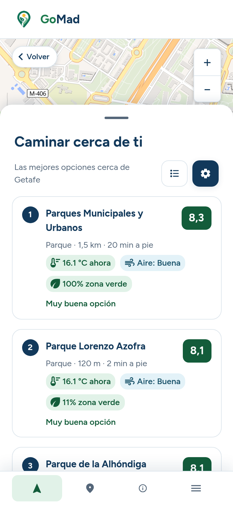
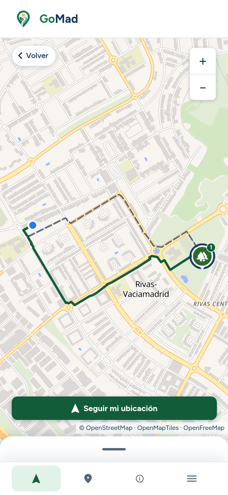
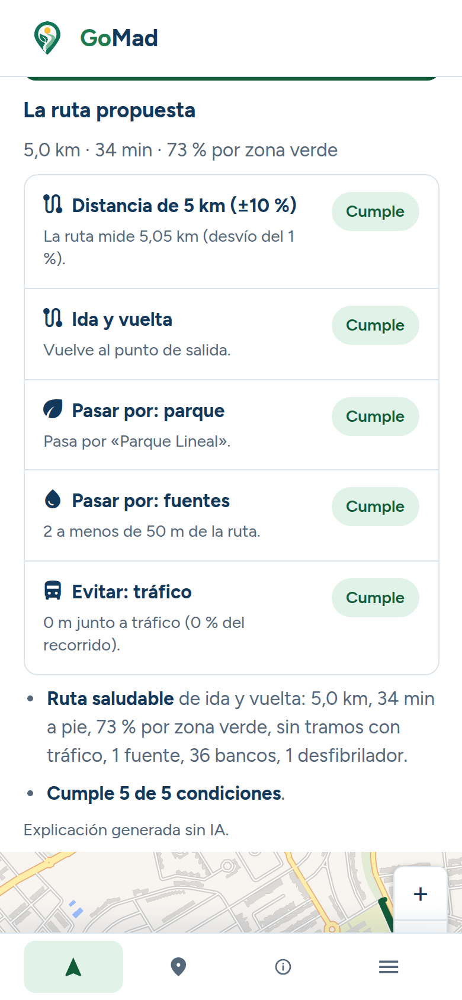
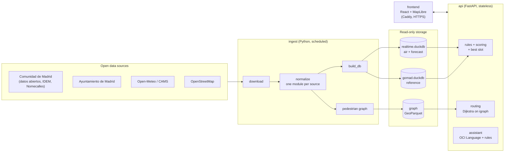

# GoMad

**Where and when to be active outdoors in the Community of Madrid — recommendations built on open data.**

Finalist · MAD Open Data Challenge 2026 · Built by a team of 4 in under a week (Oct 14–19, 2026)

<!-- SCREENSHOTS: docs/screenshots/home.png, results.png, route.png, assistant.png -->
<p align="center">
  
  
  
  
</p>

## The problem

Deciding where to go for a walk, a run or a bike ride depends on things that change by the hour and by the street: heat, air quality, rain, shade, green areas, drinking fountains. The data exists — spread across dozens of regional and municipal open-data portals in different formats, projections and update cycles — but nobody can combine it in their head before leaving home.

## The solution

GoMad combines that data for all 179 municipalities of the Community of Madrid and answers three questions from a mobile web app:

- **Where?** The top places for an activity near you, each with a 0–10 score broken down by factor (air, heat, rain, green, distance).
- **When?** The best time slot in your time window, evaluated hour by hour against the forecast and air quality.
- **How do I get there?** A direct route and a *healthy* route side by side: more green, less traffic, with fountains, benches and defibrillators along the way.

It also shows indicators per municipality and has an assistant that turns free text ("a 5 km walk in the shade this afternoon") into editable search parameters.

**Design principle: the rules engine decides; AI only interprets.** Recommendations, scores and routes are deterministic and explainable. Every factor shows its data source and update date. The assistant extracts entities with OCI Language and maps them to a closed dictionary; it never picks destinations or computes routes.

**Privacy:** no sign-up, preferences stay in the browser, and location is used only for the request (never logged).

## Architecture



- **Ingestion** downloads only what changed (CKAN metadata, `ETag`/`Last-Modified`). It then normalizes encodings, decimal commas, projections (EPSG:25830 → 4326) and municipality codes, and writes GeoParquet. Finally it builds the DuckDB databases atomically.
- **Recommendation** (`POST /recommend`): candidates within a radius → real walking distance with a bounded Dijkstra → hourly hard filters (rain, heat, air-quality thresholds from the BOE and the national heat plan) → weighted score → best slot → template-based explanation.
- **Routing**: the pedestrian graph of the whole region (~2.4 M nodes, 2.6 M edges) is held in memory. The per-request edge cost is vectorized with NumPy (length × a factor for traffic, green and other criteria, with a floor so the cost stays positive).
- **Frontend**: mobile-first SPA built with accessibility in mind (WCAG 2.1 AA as a target): the result list is a full equivalent of the map, and the app is keyboard navigable and announces updates to screen readers.

More detail (in Spanish): [`docs/arquitectura.md`](docs/arquitectura.md) · [`docs/informe-datos.md`](docs/informe-datos.md).

## Tech stack

| Layer | Technologies |
|---|---|
| Frontend | React 19, TypeScript, Vite, React Router, MapLibre GL, Radix UI, Vitest |
| API | Python, FastAPI, Pydantic, DuckDB, igraph, SciPy, NumPy |
| Data | GeoPandas, GeoParquet, pyrosm (OSM), DuckDB |
| AI | OCI Language (entity extraction) behind a provider interface |
| Infra | Docker Compose, Caddy (automatic HTTPS), Oracle Cloud (OCI) VM |
| Quality | 670 pytest tests and 374 Vitest tests, OpenAPI contract shared by API and frontend |

## Running it locally

Requirements: Docker with Docker Compose. Building the full regional graph needs about 4 GB of RAM.

```bash
git clone https://github.com/nahuel-sebastian/gomad-app.git
cd gomad-app/app

# 1. Download, normalize and build the data and the graph into app/data (first run only)
docker compose -f deploy/docker-compose.init.yml run --rm ingest

# 2. Start the API and the frontend
docker compose -f deploy/docker-compose.yml up -d --build
```

Then open http://localhost. No API keys are needed: the weather forecast comes from Open-Meteo. The OCI Language assistant is optional; without credentials it falls back to the built-in dictionary (see `app/.env.example`).

Tests:

```bash
# Python 3.12
cd app/api    && python3 -m venv .venv && .venv/bin/pip install -e '.[dev]'         && .venv/bin/pytest -q
cd app/ingest && python3 -m venv .venv && .venv/bin/pip install -e '.[dev,routing]' && .venv/bin/pytest -q

# Frontend (Node 20.19+)
cd app/frontend && npm ci && npm test
```

Tests that need the downloaded datasets are skipped until step 1 has been run.

## Data sources

Comunidad de Madrid open data (including IDEM and Nomecalles), Ayuntamiento de Madrid, Open-Meteo and CAMS, OpenStreetMap (via Geofabrik), the BOE (air-quality index thresholds) and the Ministry of Health (heat thresholds). Each source is attributed under its own license in [`app/config/sources.yaml`](app/config/sources.yaml) and in the app.

## Context

- **Event:** MAD Open Data Challenge 2026 (UC3M). The project was selected in the ideas phase and then built and presented as a finalist.
- **Timeline:** development from October 14 to 19, 2026; live demo on October 20.
- **Deployment:** it ran on an Oracle Cloud VM with HTTPS during the challenge. That environment was temporary, so there is no public demo link.
- **Team:**
  - Nahuel Sebastian Vargas ([@nahuel-sebastian](https://github.com/nahuel-sebastian))
  - Manuel Roldán Matea ([@mroldanmatea](https://github.com/mroldanmatea))
  - Javier Rosales Lozano ([@JRosales04](https://github.com/JRosales04))
  - Jaime del Campo Montaña ([@The-Aces-333](https://github.com/The-Aces-333))

## My contribution

This was a team effort with a shared codebase. I worked across the stack, on the frontend, the data pipeline, the API and the deployment, and on the technical planning and documentation. The commit history in this repository is the original one, kept so each contribution stays visible.

## How it was built

We used AI-assisted development (Claude Code) throughout. The architecture, the decisions and the review of every change were made by the team, and the commit history keeps the AI co-author trailers. Code is in English; the interface and the internal documentation are in Spanish.

---

This repository is a curated copy of the team's working repository. Planning documents, challenge materials and infrastructure details have been removed. All rights reserved by the authors.
